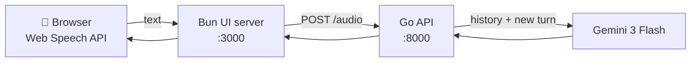

# Voice Todo Agent

**Talk to your to-do list.** Click, speak, and a Gemini-powered assistant remembers and manages your to-do items across the conversation.

    

## Why I built it

I wanted a hands-free way to capture tasks, and an excuse to build a small polyglot AI app end to end: a lightweight TypeScript UI, a Go API service, and an LLM with conversational memory. Along the way the backend went through a Rust REST experiment before settling on Go.

## Features

- **Voice input** — speech-to-text in the browser via the Web Speech API
- **Conversational memory** — the backend keeps session history, so the assistant remembers earlier to-do items
- **Clean separation** — Bun serves the UI and proxies requests; Go owns all model calls and the API key
- **Gemini provider package** — text, streaming and audio-transcription helpers in Go
- **Clear error handling** — JSON errors with proper HTTP status codes (400, 405, 502)

## How it works



## Quick start

Requires [Bun](https://bun.com), Go 1.25+ and a [Gemini API key](https://aistudio.google.com/apikey).

```bash
# 1. Install UI dependencies
bun install

# 2. Start the Go backend
export GEMINI_API_KEY="your_api_key_here"
cd src && go run ./api

# 3. In another terminal, start the UI
bun run index.ts
```

Open http://localhost:3000 and click to talk. Set `BACKEND_URL` to point the UI at a different backend, or `PORT` to change the UI port.

## Project structure

```
index.ts                  Bun server entry point
src/router.ts             UI routes + proxy to the Go backend
src/ui/page.tsx           Voice UI (HTML/CSS/JS)
src/api/main.go           Go HTTP API (POST /audio)
src/providers/gemini/     Gemini text, streaming and transcription
```

## Tech stack

TypeScript · Bun · Go · Gemini (`google.golang.org/genai`) · Web Speech API

## License

MIT
